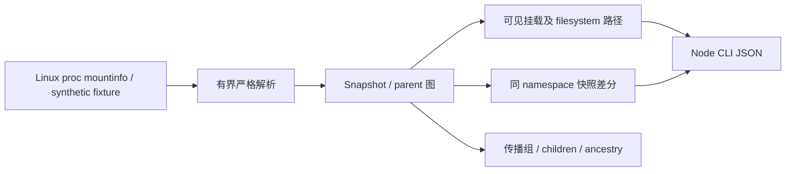

# MoonMount

一个为 MoonBit 生态提供 Linux 挂载拓扑、路径归属解释与快照变化分析能力的开源项目。

面向容器诊断、部署检查、开发工具：容器里的路径不一定来自直觉中的设备；bind mount 的文件系统内部 root、叠加挂载遮住的旧子树、共享传播关系不能只靠磁盘容量表解释。调研证据与范围见根目录三份报告。

已有 sysinfo/Disks 提供容量和挂载点，chokidar 观察文件事件，moondisk 扫描目录。本项目增加 mountinfo 对象模型、parent 图、可见路径遍历、filesystem 内路径、传播组和 namespace 内差分。独立原创，参考 Linux 文档，不复制 libmount 实现。

根包拥有全部公共类型，纯 MoonBit 实现。Node CLI 只做有界文件读取、namespace token、参数与输出；支持 Linux JS live，Windows/Linux JS 与 Wasm-GC 离线核心。无第三方运行依赖，不声明 native 后端。

MVP：完整 mountinfo 字段与四种转义；未知 optional 字段保留；正整数/预算/重复 ID/环检测；缺失父节点允许；mount 与 super options 分开；共享 peer/master 组；按 parent 图处理叠加挂载；bind 内部路径；差分 added/removed/changed/replaced；namespace 不同拒绝比较。3 分钟 demo 和必要错误测试。

路径是 namespace 根下的规范绝对路径，不解析符号链接，不声称检查文件存在或权限。UTF-8 文本输入；不支持非 UTF-8 文件名。mount ID 可复用，只能识别可观察身份变化，无法证明两次相同记录之间从未卸载重建。快照不是事件订阅，不提供自动 mount/umount。

验证：核心 JS/Wasm-GC；Linux 只读 /proc/self/mountinfo；findmnt 对照结构字段；独立 Python oracle 比较 fixture；实际 moon package 归档消费。新增失败做针对性回归，兼容 API 按版本维护。计划不含网页、权限修改、自动修复。

三分钟：0-30 秒解释容器路径问题；30-90 秒 synthetic overmount 演示旧子树隐藏与 bind 内部路径；90-140 秒 namespace 差分和传播关系；140-180 秒 Linux 实际采集/findmnt 对照及错误边界。

规则：2026-10-18 读取官方 Hackathon2026/src/App.tsx（JS 页面正文经 raw GitHub 获取）。十月报名/验收截止 10 月 31 日、最多提交 3 次、每队最多 3 人；要求 MoonBit 主体、公开持续记录和可运行交付。次数主体与修改计算不自行推断，不进行报名。

本地临时模块 local/moonmount，版本 0.1.0，MIT。GitHub owner/repo、公开 Git 身份、Mooncakes namespace、参赛者资料均待定。只本地交付；真实阶段提交使用中性本地身份，不代表用户公开身份，不补造公开时间。

## 2026-10-20 验收完善

复核官方当前六项验收标准；修复合法 CR/控制字符和 source/type 的 # 引用，公共 API 不变。验证命令可从新解压目录运行，时间戳改为实际执行时间；新增隔离 mount namespace 的真实 overmount/remount 对照。公开发布和连续公开记录尚未执行，不以本地 Git 历史代替。
